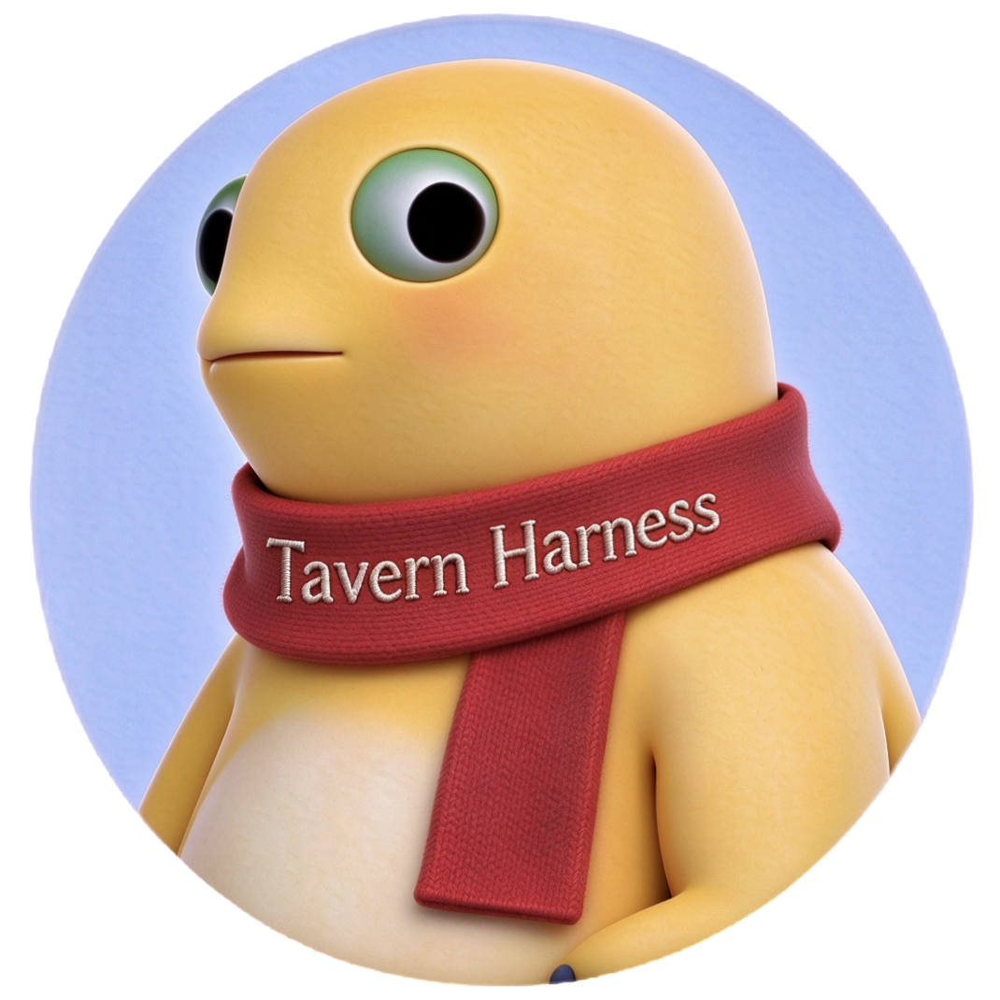
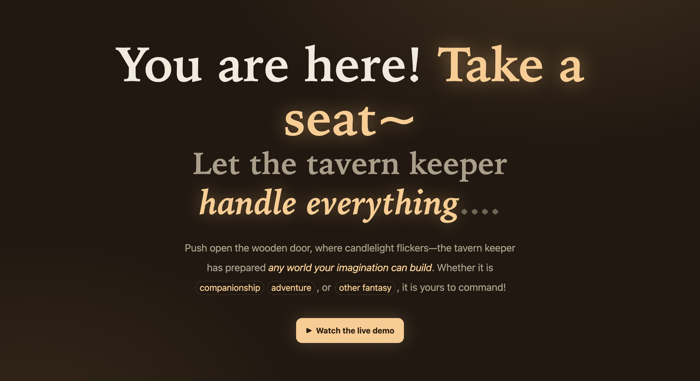

<p align="center">
  <a href="https://rannichan.github.io/Tavern-Harness/">
    
  </a>
</p>
<p align="center">
  <a href="https://github.com/Rannichan/Tavern-Harness"></a>
  <a href="https://discord.gg/kPSWGeaHx"></a>
  <a href="https://rannichan.github.io/Tavern-Harness/wiki.html"></a>
  <a href="https://www.npmjs.com/package/tavern-harness"></a>
</p>

<p align="center">
  <strong>English</strong> | <a href="README.zh.md">简体中文</a>
</p>

# Tavern Harness · An AI-Native Role-Playing Sandbox

<a id="demo"></a>
## 1 · Gameplay Demos

[](https://rannichan.github.io/Tavern-Harness/index.html#demo)

<a id="run"></a>
## 2 · Getting Started

### Option 1: One-Command Start (Recommended)

No repository clone or global installation is required:

```bash
npx tavern-harness
```

The first run downloads the package, starts a service accessible on your LAN, and opens your browser automatically. Optional arguments:

```bash
npx tavern-harness --no-open
npx tavern-harness --port 5273
npx tavern-harness --host 127.0.0.1  # Restrict access to this computer
npx tavern-harness --workspace /absolute/path/to/workspace
```

### Option 2: Global Installation (Recommended for Regular Use)

Install once, then start Tavern Harness from any directory:

```bash
npm install -g tavern-harness
tavern-harness
```

To update it:

```bash
npm update -g tavern-harness
```

To uninstall it:

```bash
npm uninstall -g tavern-harness
```

### Option 3: Build from Source

```bash
git clone https://github.com/Rannichan/Tavern-Harness.git
cd Tavern-Harness
npm install
npm run dev      # Defaults to port 5173 and automatically tries the next port if occupied
```

### Configure a Model Provider on First Launch

After starting the app, open **Settings → Model Service Provider**:

1. **Add a provider**: enter a name, Base URL, and API Key. Any OpenAI-compatible `chat/completions` API is supported, including OpenAI, DeepSeek, Qwen, SiliconFlow, Ollama, LM Studio, and self-hosted vLLM.
2. **Test the connection**: the app fetches the model list. If the browser cannot connect directly, it tries the built-in same-origin proxy; the original Base URL remains in the settings.
3. **Select a model**: click the model name at the top of the chat page, then return to the conversation and start chatting.

### Use Bailian Token Plan Personal

1. Subscribe and create a personal Token Plan API key (starting with `sk-sp-`) using the [Bailian quick start](https://help.aliyun.com/zh/model-studio/token-plan-personal-quick-start). Pay-as-you-go and Coding Plan keys are separate.
2. Under **Settings → Model Providers**, choose **Add Bailian Token Plan Personal**, enter your key, and select **Fetch models**. Text and speech models are listed separately. Enable the text models you want, save, and choose a default text model. If the model-list endpoint is unavailable, use the presets or add IDs from the [official model list](https://help.aliyun.com/zh/model-studio/token-plan-personal-overview).
3. To use voice, turn on **Key dialogue voices**, choose a provider, speech model and voice, then save. The Bailian preset uses `qwen-audio-3.0-tts-plus` and `longanlingxin` by default. OpenAI-compatible `/audio/speech` services can also be configured.
4. During chat, the current text model makes an additional decision about whether a reply contains a key line worth voicing; only an exact excerpt is sent for synthesis. Both calls may consume credits. Audio is stored locally with the message for replay; automatic playback depends on browser permissions.

The key is stored on the Tavern Harness host and shared by browsers using the same instance; conversations and selected lines are sent to their configured model services. See the [official terms and model list](https://help.aliyun.com/zh/model-studio/token-plan-personal-overview) for permitted use and data handling. Bailian voice uses the [Token Plan speech API](https://help.aliyun.com/zh/model-studio/token-plan-speech-synthesis), not the separately billed Harness benefits.

For OpenAI's own service, `tts-1`, `tts-1-hd`, and `gpt-4o-mini-tts` are scheduled to shut down on January 6, 2027. This integration uses `/audio/speech` and does not yet implement the Realtime API; see the [official OpenAI documentation](https://developers.openai.com/api/docs/guides/text-to-speech).

### Import a Gameplay and Start Playing

Download the gameplay file below. Click **Import** in the upper-left corner, then import the file you downloaded to create a complete game environment—including characters, lorebooks, skills, and more—and start playing right away:

[th-demo-affinity-gameplay-en.json](./docs/assets/gameplay/th-demo-affinity-gameplay-en.json)

### Data Storage

Tavern data is stored locally on the host and shared by browsers that open the same Tavern Harness instance. Language and theme remain browser-specific.

<a id="features"></a>
## 3 · Features

### 🍺 The Tavern Keeper Is Always Ready to Help

Whether you are creating a character card, designing a tabletop RPG scenario, or simply unsure where to begin, ask the Tavern Keeper.

The tavern is designed around AI assistance to make creating and playing games easier.

### 🛠️ Skill System

Characters are more than chat partners: they are **agents with extensible skills**. Equip each character with the abilities needed for richer gameplay.

The tavern includes essential skills such as dice rolling and a default, editable **Memory** skill. Memory lets characters keep important preferences, world details, plot progress, and agreements in a local long-term-memory store. You can also ask the Tavern Keeper to **create any skill you need**.

### 💬 Multi-Character Group Chats

Each room supports up to **six characters** and provides a turn-order board for managing group conversations.

Use **@mentions** and **skip** to create natural multi-character scenes—whether observing from above or role-playing as part of the group.

### 🎁 Share Your Game with Friends

Compatible with the **Tavern ecosystem**, including one-click PNG character-card imports.

You can also export and share an entire game: recipients can import it and play immediately without manually creating characters, skills, or conversation settings.

### 🍃 Fully Local / High Cache Hit Rates / Clean

The app supports **OpenAI-format APIs**. Use a hosted API plan or run a model locally; your data remains on your device.

Tavern Harness is optimized to improve cache hit rates, significantly reducing token costs.

Tavern Harness has no external harness dependency, and its UI is designed for a clean, focused experience.

<a id="feedback"></a>
## 4 · Community and Feedback

- 🐛 Found a bug or have a feature request? Open a [GitHub Issue](https://github.com/Rannichan/Tavern-Harness/issues). You are welcome to attach exported game JSON or browser-console logs, but always remove API keys first.
- 🟣 For usage discussions, gameplay ideas, character and skill sharing, or development updates, join the [Discord community](https://discord.gg/kPSWGeaHx).
- 🤝 Pull requests are welcome.
- 📣 Star or watch the repository to receive updates.

> The tavern is open 24 hours a day, and the Keeper is always here to help.

## 5 · Changelog

Every npm release is recorded in [`changelog/`](changelog/): one file per version, matched one-to-one with a git tag.

- Read the full history: [CHANGELOG.md](https://github.com/Rannichan/Tavern-Harness/blob/main/CHANGELOG.md)
- In the app: **Settings → About → View version history**
- Maintainers: follow the release steps in [CONTRIBUTING](CONTRIBUTING.md#releases-and-changelog).

## License

This project is licensed under the [MIT License](LICENSE).
