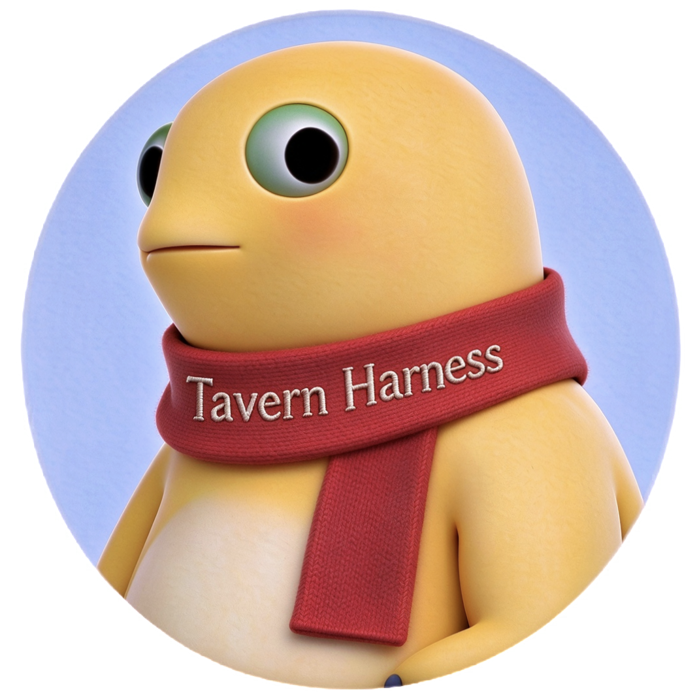
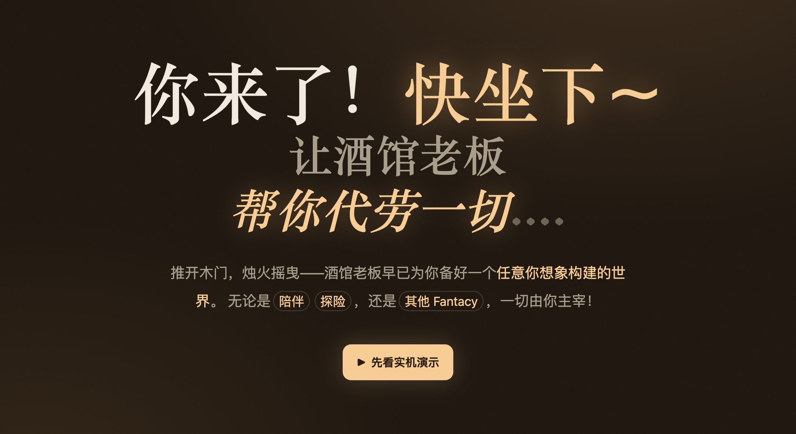

<p align="center">
  <a href="https://rannichan.github.io/Tavern-Harness/">
    
  </a>
</p>
<p align="center">
  <a href="https://github.com/Rannichan/Tavern-Harness"></a>
  <a href="https://discord.gg/kPSWGeaHx"></a>
  <a href="https://rannichan.github.io/Tavern-Harness/wiki.html"></a>
  <a href="https://www.npmjs.com/package/tavern-harness"></a>
</p>

<p align="center">
  <a href="README.md">English</a> | <strong>简体中文</strong>
</p>

# Tavern Harness · AI 原生的角色扮演沙盒

<a id="demo"></a>
## 1 · 玩法演示

[](https://rannichan.github.io/Tavern-Harness/index.html#demo)

<a id="run"></a>
## 2 · 如何运行

### 方式一：一键启动（推荐）

无需克隆仓库或全局安装：

```bash
npx tavern-harness
```

首次运行会下载包、启动可从局域网访问的服务，并自动打开浏览器。可选参数：

```bash
npx tavern-harness --no-open
npx tavern-harness --port 5273
npx tavern-harness --host 127.0.0.1  # 仅允许本机访问
npx tavern-harness --workspace /absolute/path/to/workspace
```


### 方式二：全局安装（推荐长期使用）

安装一次后，可从任意目录启动 Tavern Harness：

```bash
npm install -g tavern-harness
tavern-harness
```

更新：

```bash
npm update -g tavern-harness
```

卸载：

```bash
npm uninstall -g tavern-harness
```

### 方式三：从源码安装

```bash
git clone https://github.com/Rannichan/Tavern-Harness.git
cd Tavern-Harness
npm install
npm run dev      # 开发服务器默认端口 5173，被占用时自动顺延
```

### 首次启动配置模型服务

启动后到「**设置 → 模型服务 Provider**」：

1. **添加 Provider**：名称 + Base URL + API Key —— 支持任意 OpenAI 兼容 `chat/completions` 接口（OpenAI / DeepSeek / Qwen / SiliconFlow / Ollama / LM Studio / 自建 vLLM 均可）
2. **测试连接**：自动拉取模型列表。若浏览器无法直连，会尝试通过内置同源代理转发；配置中保留原始 Base URL。
3. **选模型**：聊天页顶部点击模型名即可，回到对话开聊！

### 使用百炼 Token Plan 个人版

1. 在[百炼 Token Plan 个人版控制台](https://help.aliyun.com/zh/model-studio/token-plan-personal-quick-start)订阅并生成个人版专属 API Key（以 `sk-sp-` 开头）。它与百炼按量计费或 Coding Plan 的 Key 不通用。
2. 在「设置 → 模型服务 Provider」点击「添加百炼 Token Plan 个人版」，填入自己的 Key，点击「拉取模型」。文本与语音模型分开显示；启用需要的文本模型后保存，并在设置中选择默认文本模型。如果列表接口不可用，仍可使用预设或参照[官方模型列表](https://help.aliyun.com/zh/model-studio/token-plan-personal-overview)手动添加。
3. 如需配音，在「关键对话语音」开启自动配音，选择 Provider、语音模型与音色，再保存。百炼个人版默认使用 `qwen-audio-3.0-tts-plus` 和 `longanlingxin`；也可配置支持 `/audio/speech` 的 OpenAI 兼容服务。
4. 开始对话后，当前文本模型会额外判断每条回复是否有适合配音的关键台词，只有选中的原文片段才会调用语音模型。判断和合成可能消耗额度。生成的音频随消息保存在本地，可重播；自动播放取决于浏览器是否允许。

Key 保存在运行 Tavern Harness 的主机上，同一实例的浏览器共享；对话及待配音台词会发送至相应模型服务。个人版的使用范围、内容使用和支持模型以[官方说明](https://help.aliyun.com/zh/model-studio/token-plan-personal-overview)为准。百炼配音使用 [Token Plan 原生语音接口](https://help.aliyun.com/zh/model-studio/token-plan-speech-synthesis)，不包含独立计费的 Harness 附加权益。

如果使用 OpenAI 官方语音服务，请注意 `tts-1`、`tts-1-hd` 和 `gpt-4o-mini-tts` 已计划于 2027 年 1 月 6 日停用；此项目的兼容接入使用 `/audio/speech`，尚未实现 Realtime API。具体以 [OpenAI 官方文档](https://developers.openai.com/api/docs/guides/text-to-speech)为准。

### 导入游戏并开始

下载以下游戏文件，点击左上角的「导入」按钮，然后导入刚刚下载的文件，即可创建一整套游戏环境（包括角色、世界书、技能等），直接体验：

[小咕嘎-gameplay.json](./docs/assets/gameplay/小咕嘎-gameplay.json)

### 数据存储

酒馆数据保存在主机本地；访问同一 Tavern Harness 实例的浏览器可共享这些数据。界面语言和主题仍随各自浏览器保存。

<a id="features"></a>
## 3 · 产品特色

### 🍺 酒馆老板随时为您服务

无论是构建角色卡这种小事儿，还是设计跑团玩法这种累活儿，再或者你只是不知道从何入手，都可以来找酒馆老板！

我们为酒馆进行了全方位的 AI 装修，让游戏的创建和体验都更加简单。

### 🛠️ 技能系统

所有的角色不再是只能对话的角色，而是**具备技能拓展的智能体**：为每一个角色装备需要的技能，实现更高级的玩法。

酒馆已经提供了一些必要的技能（例如掷骰子和默认提供的、可编辑的**记忆**技能）。记忆技能会把重要的偏好、世界设定、剧情进展和约定保存到本地长期记忆中；同时你也可以拜托酒馆老板，**创建任意你想要的技能**~

### 💬 多角色群聊

每个房间支持添加**至多 6 个角色**，并提供类似于回合制游戏的行动顺序表，轻松管理多人对话。

支持 **@ 角色** 和**跳过**，模拟真实的多人对话场景——无论是从上帝视角观测角色们的行为，还是亲自代入角色参与其中，总能找到你的玩法。

### 🎁 和朋友分享你的游戏

兼容 **Tavern 生态**，一键导入 PNG 角色卡。

同时支持**游戏一键打包分享**：对方直接导入即可游玩，无需手动创建角色、技能、配置对话。

### 🍃 完全本地 / 高缓存命中率 / 简洁干净

目前支持 **OpenAI 格式的 API 接口**：你可以使用你的 token plan，也可以自己本地部署模型，一切数据都保存在本地。

Tavern Harness 针对提高缓存命中率进行了优化，显著降低了 Token 成本。

并且 Tavern Harness 不依赖任何外部 harness，UI 也经过了精细打磨，提供简洁干净的体验。

<a id="feedback"></a>
## 4 · 交流反馈

- 🐛 发现 Bug / 提需求 → [GitHub Issues](https://github.com/Rannichan/Tavern-Harness/issues)，欢迎附上导出的游戏 JSON 或浏览器控制台日志（务必注意脱敏 API Key 哦）
- 🟣 用法讨论 / 玩法灵感 / 分享你的角色卡与技能 / 围观开发进展 → 加入 [Discord 社区](https://discord.gg/kPSWGeaHx)
- 🤝 欢迎提交 Pull Request：我最喜欢写bug了
- 📣 想第一时间收到更新，点个 Star / Watch 就好

> 酒馆24小时营业，老板随时为您服务！

## 5 · 版本记录

每一次 npm 发布都会记录在 [`changelog/`](changelog/) 目录中：一个版本一个文件，并与 git tag 一一对应。

- 查看完整记录：[CHANGELOG.md](https://github.com/Rannichan/Tavern-Harness/blob/main/CHANGELOG.md)
- 应用内查看：**设置 → 关于 → 查看版本记录**
- 维护者：发布步骤见 [CONTRIBUTING](CONTRIBUTING.md#releases-and-changelog)。

## 开源协议

本项目采用 [MIT License](LICENSE) 开源协议。
